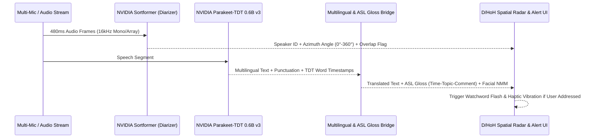

# ASLytics Technical Architecture

## 1. End-to-End On-Device Pipeline

ASLytics is architected specifically for **low-latency, privacy-preserving group conversation comprehension** for Deaf and Hard-of-Hearing (D/HoH) users. Unlike generic cloud transcription services, every stage runs on-device:

---

## 2. Core Model Components

### A. Acoustic & Multilingual ASR: `nvidia/parakeet-tdt-0.6b-v3`
- **Encoder**: FastConformer with 8x depthwise-separable convolutional subsampling (efficient on edge CPUs, Apple Neural Engine/Metal, and NVIDIA GPUs).
- **Decoder**: Token-and-Duration Transducer (**TDT**). By predicting token durations jointly with tokens, TDT skips blank frames during inference and emits accurate **word-level timestamps** directly from the acoustic forward pass.
- **Multilingual Coverage**: 25 languages with automatic language detection, native capitalization, and punctuation.

### B. Cross-Lingual Speech Translation: `nvidia/canary-1b-v2`
- Used when direct speech-to-text translation (AST) is preferred over two-stage ASR + text translation.

### C. Multi-Speaker Group Diarization: `nvidia/diar_sortformer_4spk-v1`
- Resolves the **"cocktails & conference table" problem** by sorting speaker turns in arrival order and explicitly flagging overlapping speech intervals (`is_overlapping = True`) so simultaneous utterances are never concatenated into a single confusing caption line.

---

## 3. American Sign Language (ASL) Gloss & Non-Manual Marker Engine

Written English follows Subject-Verb-Object (SVO) word order with heavy auxiliary verb and article usage, whereas ASL uses a visual-spatial **Time-Topic-Comment** structure paired with facial grammar (**Non-Manual Markers / NMM**):

1. **Temporal Fronting**: Time words (`TODAY`, `TOMORROW`, `NOW`, `ALREADY`, `MORNING`) are extracted and placed at the start of the clause followed by a `/` boundary marker.
2. **Copula & Article Pruning**: Non-signed English grammar tokens (`the`, `a`, `an`, `is`, `are`, `am`, `was`, `were`) are stripped.
3. **Lexical Root & Indexing**: Pronouns and continuous verbs map to canonical sign glosses (`IX-ME`, `IX-YOU`, `ALL-YOU`, `FINISH-UPDATE`).
4. **Facial NMM Annotation**:
   - Polar questions (`YES-NO-Q`) attach `BROW-RAISE (Yes/No Question)`.
   - Content questions (`WH-Q`) move WH-words (`WHO`, `WHAT`, `WHERE`, `WHEN`, `WHY`, `HOW`) to clause-final position and attach `BROW-FURROW (WH-Question)`.
   - Negations attach `HEAD-SHAKE (Negation)`.
