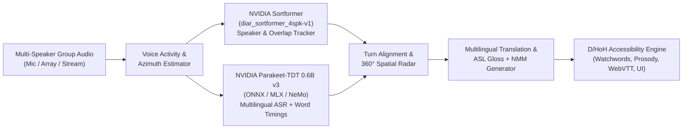

# 🤟 ASLytics — On-Device Multilingual Group Conversation Accessibility

[](LICENSE)
[](https://huggingface.co/nvidia/parakeet-tdt-0.6b-v3)
[](#architecture)

**ASLytics** is an open-source, privacy-first assistive intelligence platform built for the **Deaf and Hard-of-Hearing (D/HoH) community** to effortlessly follow and participate in **fast-paced, multi-speaker, multilingual group conversations** completely **on-device** using **NVIDIA Parakeet AI** (`nvidia/parakeet-tdt-0.6b-v3`), **NVIDIA Canary** (`nvidia/canary-1b-v2`), and **NVIDIA Sortformer** (`nvidia/diar_sortformer_4spk-v1`).

---

## 🎯 Why Group Conversations Are Hard — And How ASLytics Solves It

Standard live-captioning tools are built for single-speaker dictation and break down in real-world group settings (family dinners, team standups, classrooms, and study groups):

| Challenge for Deaf & Hard-of-Hearing Participants | How **ASLytics** Solves It On-Device |
| :--- | :--- |
| **1. "Who is speaking and where do I look?"**<br>By the time a D/HoH participant scans a table to see who started talking, they have already missed 2–3 seconds of lip-reading and facial expression. | **360° Spatial Group Table Radar & Arrival-Order Diarization (`Sortformer`)**<br>Color-coded speaker badges, clock-face directional seating cues (`Front-Right 2 o'clock`), and angular head-turn indicators (`Turn head 65°`). |
| **2. Overlapping Speech & Crosstalk**<br>When two people speak at once, conventional ASR merges their words into a single unintelligible sentence. | **Explicit Overlap Separation & Visual Alerts**<br>Detects concurrent speech turns, separates speaker attributions, and displays an `[OVERLAP w/ Speaker]` badge. |
| **3. Multilingual Households & Global Teams**<br>Conversations that switch between English, Spanish, French, German, Punjabi, or Hindi leave single-language captioners behind. | **Multilingual FastConformer-TDT (`parakeet-tdt-0.6b-v3`)**<br>Recognizes 25+ languages with native word-level timestamps & punctuation, plus inline translation. |
| **4. Reading Fatigue in Fast Discussions**<br>Dense walls of English text are exhausting for native signers during rapid group back-and-forth. | **ASL Gloss Bridge & Non-Manual Markers (NMM)**<br>Transforms spoken utterances into **Time-Topic-Comment** American Sign Language Gloss with facial grammar cues (`BROW-RAISE`, `BROW-FURROW`, `HEAD-SHAKE`). |
| **5. Missing Name-Calls & Room Cues**<br>Not knowing when someone calls your name or when the room laughs/applauds. | **Watchword Visual/Haptic Flash & Sound Cues**<br>Flashes a high-contrast banner and triggers device vibration (`navigator.vibrate`) when your name or custom watchwords are spoken. |

---

## 🏗️ System Architecture



---

## 🧠 Supported On-Device Models

ASLytics supports 4 interchangeable local execution backends (`onnx`, `mlx`, `nemo`, and zero-download `simulation` mode):

| Model Key | Official Checkpoint | Architecture | Params | Languages | Target Use Case |
| :--- | :--- | :--- | :---: | :---: | :--- |
| `parakeet-tdt-0.6b-v3` | `nvidia/parakeet-tdt-0.6b-v3`<br>`istupakov/parakeet-tdt-0.6b-v3-onnx`<br>`mlx-community/parakeet-tdt-0.6b-v3` | FastConformer + Token-and-Duration Transducer (TDT) | 600M | **25** | **Default**: High-speed multilingual group transcription with word timestamps & punctuation |
| `parakeet-tdt-0.6b-v2` | `nvidia/parakeet-tdt-0.6b-v2` | FastConformer-TDT | 600M | 1 (EN) | Ultra-low-latency English-only edge devices (~3380x RTFx) |
| `canary-1b-v2` | `nvidia/canary-1b-v2` | FastConformer Encoder + Transformer Decoder | 1.0B | **25** | Heavy cross-lingual speech-to-text translation (AST) |
| `sortformer-4spk-v1` | `nvidia/diar_sortformer_4spk-v1` | Sortformer Arrival-Order Transformer | 118M | Agnostic | Multi-speaker diarization and overlapping speech resolution |

---

## 🚀 Quickstart

### 1. Clone & Run Immediately (Zero-Download Demo Mode Included)

```bash
git clone https://github.com/MANKANWAR/ASLYTICS.git
cd ASLYTICS

# Run a multilingual 4-speaker standup scenario right in your terminal
python3 -m aslytics demo --scenario multilingual_standup

# Or try the multigenerational family dinner scenario (English / Punjabi / Hindi)
python3 -m aslytics demo --scenario family_dinner
```

### 2. Launch the Accessible Group Conversation Web UI

```bash
python3 -m aslytics serve --port 8765
```
Then open **`http://127.0.0.1:8765`** in your browser to use:
- **360° Spatial Group Table Radar** with directional gaze beams
- **Live Multilingual Captions + ASL Gloss & Facial NMM Bar**
- **High-Contrast Dark / Daylight Themes & Large-Print Scaling (`100%` / `125%` / `150%`)**
- **Live Mic Input & D/HoH Quick Reply ("Speak & Show Card to Group")**
- **One-Click Accessible `.VTT` Subtitle Export**

### 3. Enable Hardware-Accelerated On-Device Weights

Choose the backend matching your device:

```bash
# Option A: Cross-Platform CPU / Edge Laptop (ONNX Runtime INT8/FP16)
pip install -e ".[onnx]"

# Option B: Apple Silicon Mac M1/M2/M3/M4 (Metal MLX Acceleration)
pip install -e ".[mlx]"

# Option C: NVIDIA GPU Workstation / Jetson Orin (Full NeMo + Sortformer)
pip install -e ".[nemo]"
```

---

## 🧪 Running Tests

```bash
python3 -m unittest discover -s tests -v
```

---

## 🤝 Contributing & Community

We welcome contributions from Deaf and Hard-of-Hearing advocates, ASL interpreters, speech ML engineers, and accessibility designers! Please see [CONTRIBUTING.md](CONTRIBUTING.md) and our [Code of Conduct](CODE_OF_CONDUCT.md).

## 📄 License

Licensed under the [Apache License 2.0](LICENSE).
